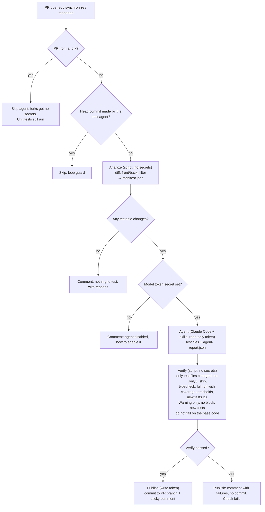
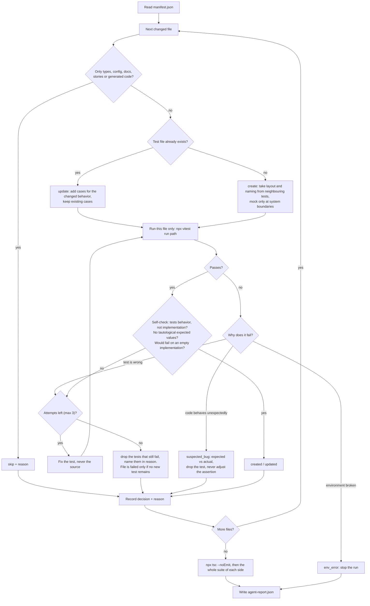

# Unit Test Agent: solution notes

This repository adds a Claude Code agent, three skills and a GitHub workflow that write unit tests for the Taskly app on every pull request. The agent decides per changed file whether to create tests, update tests or skip. A script then checks its work without trusting it. Only checked tests are committed to the pull request, together with one comment that shows what the agent decided and why.

Contents: [How it works](#how-it-works), [Where things live](#where-things-live), [Technical decisions](#technical-decisions), [Security](#security), [Running it](#running-it), [Example run](#example-run), [Results](#results), [Assumptions](#assumptions), [Limitations](#limitations), [Changes for production](#changes-for-production).

## How it works

The workflow is `.github/workflows/test-agent.yml`. It has four jobs, and only one of them calls a model.

| Job | Runs | Permissions | What it does |
|---|---|---|---|
| Analyze | script | read only | Lists the changed files, drops what cannot be unit tested (types, generated code, stories, docs, config) and writes `manifest.json` with the PR title and description. If nothing is testable the agent never starts. |
| Write tests | Claude Code | read only, plus the model token | Reads the manifest, decides create, update or skip for each file, writes test files and `agent-report.json`. Its output is a patch. It pushes nothing. |
| Verify | script | read only, no model token | Applies the patch to the PR and runs deterministic checks. |
| Publish | script | write | The only job that can write. Commits the verified tests to the PR branch and creates or updates one comment. |

Verify runs these checks in order:

1. The report matches the agreed format.
2. Only test files and test fixtures changed, with no `.only` or `.skip` and no secret-like strings.
3. The patch applies to the pull request.
4. Typecheck passes in each folder the agent touched.
5. The full suite passes and coverage stays above the thresholds.
6. The agent's new tests pass three runs in a row.
7. With the changed source files put back to their old version, at least one new test file fails.

Check 7 matters most, because a test that also passes on the old code does not test the change. If no new test fails, Verify adds a warning to the comment but does not block. A refactor or a comment change can legitimately leave behavior alone.

When Verify fails, nothing is committed. The comment still lists the agent's decisions and the failed checks, and the workflow run is red.

### PR workflow



### Agent decision loop

Runs inside the Agent job for each changed file.



## Where things live

| What | Where |
|---|---|
| Agent | `.claude/agents/unit-test-agent.md`: role, tools, decision rules, error handling, success criteria, report format. It runs on `claude-sonnet-5-5` and preloads the `test-case-design` skill. |
| Skill: test design | `.claude/skills/test-case-design/`: plan the cases before any code, name the break each case catches, take expected values from the contract and not from the code. |
| Skill: backend | `.claude/skills/backend-unit-tests/` with `references/prisma-mocking.md`: which entry point to test each file through, how to fake Prisma, Supertest and environment handling. |
| Skill: frontend | `.claude/skills/frontend-unit-tests/` with `references/react-query-hooks.md`: components, hooks and the API layer, faking the network with a `fetch` stub, one `QueryClient` per test. |
| Run script | `scripts/run-agent.sh`: starts the agent headless with the same limits locally and in CI. |
| Analyze and Verify | `scripts/analyze-pr.mjs` and `scripts/verify-agent.mjs`, each with its own `node --test` file. |
| Workflows | `.github/workflows/test-agent.yml` (the agent) and `.github/workflows/unit-tests.yml` (the required CI that runs typecheck and tests with coverage). |
| Project rules for the agent | `CLAUDE.md`: commands, test conventions, what not to test. |

How the pieces are used: the workflow gives the agent a manifest. The agent preloads `test-case-design` and plans each file with it. Before writing a backend test it loads `backend-unit-tests`, and before a frontend test `frontend-unit-tests`. The skills keep their long reference material in separate files, so the agent reads it only when a file needs it.

## Technical decisions

**Claude Code as the agent environment.** The same agent file runs on a developer machine and in CI through `scripts/run-agent.sh`, so a local run and a CI run have the same tools and limits.

**A model only where judgment is needed.** Choosing what to test and writing the tests needs a model. Listing changed files, checking the result and posting the comment do not, so those are plain scripts. They are cheap, repeatable and tested themselves. When a pull request changes nothing testable, no model call happens.

**The agent proposes, a script decides.** The agent job has no write access and produces a patch. Verify applies the patch and runs checks the agent cannot influence. Publish is a separate job with the write token, and it never runs code from the pull request.

**Expectations come from the contract.** The instructions tell the agent to take expected values from the PR description, signatures, zod validators and `backend/openapi.json`, never from running the code under test. A test that copies what the code does today passes on a bug.

**Mocks only at system boundaries.** New test files fake the network, the database and time. They use the real design system and real hooks. An existing test file keeps its own mocks. If those mocks hide the behavior to test, the agent writes a separate `*.flow.test.tsx` next to it. If the change adds a dependency that the old file does not mock, the agent adds only the missing mock or prop, and changes no existing case. This rule came from the first demo run, described in the example below.

**Bounded effort, reported failures.** At most three attempts per file. A test that still fails is deleted and named in the report. A test that exposes what looks like a bug in the code is also deleted, but it is reported as `suspected_bug` with expected and actual values, and the assertion is never bent to fit the code. The turn limit is 40 locally and 60 in CI.

**One comment per pull request.** The comment is found by a hidden marker and updated on every run, so a second push does not add a second comment.

**Sonnet, not Haiku.** An evaluation on the emoji bug (issue #7) used one general rule in the skills. On `utils/todos.ts` Haiku missed the bug and Sonnet found it, at $0.21 for that file. Haiku found the same bug later in `TodoForm.tsx`, so it applies subtle rules inconsistently. Haiku is cheaper: on `router.ts` it cost $0.013 against $0.153 for Sonnet. In CI the agent sees only the changed files, so the project accepts the higher cost.

## Security

Code, comments and the PR text are treated as untrusted input, because they can contain instructions aimed at the agent. The protection is built from permissions and checks, not from a sentence in the prompt.

- Every job has the smallest permissions it needs. Only Publish can write, and it never executes code from the pull request.
- The workflow uses `pull_request`, not `pull_request_target`, so a pull request from a fork gets no secrets. The agent is skipped for forks.
- The agent job runs with `CLAUDE_CODE_SUBPROCESS_ENV_SCRUB=1`. Tests run through vitest, so any code in them could read the environment. This setting strips the model token from every subprocess. A workflow step also proves it on each run: the agent's shell commands log whether the token was visible, and the job fails if it was.
- The agent may only run `npx vitest run`, `npx tsc --noEmit` and `cd` into the two folders. It may not read `.env` files or edit source, config or package files.
- Verify rejects any change outside test files, any `.only` or `.skip`, and secret-like strings in the patch.
- The PR title and body are passed through environment variables, never pasted into a shell script.
- Actions are pinned by commit SHA. Concurrency is limited to one run per pull request.
- The agent's own commit carries `[skip ci]` and a marker, so it cannot start a loop.

## Running it

**Prerequisites.** Node 24, npm, and Claude Code (`npm install -g @anthropic-ai/claude-code`; CI pins version 2.1.301) for local runs. The Linux CI runner also needs `bubblewrap` and `socat` for the command sandbox, and the workflow installs them.

**Enable it on GitHub.** Add the repository secret `CLAUDE_CODE_OAUTH_TOKEN` (a Claude Code token). Without it the workflow still runs: the comment says the agent did not run because the secret is missing.

**Use it.** Open a pull request from a branch in the same repository. After a few minutes the agent's commit and comment appear. Pushing again re-runs everything and updates the same comment.

**Run the agent locally.** From the repository root, after `npm ci` in `backend/` and `frontend/`:

```sh
scripts/run-agent.sh "Write tests for backend/src/features/todos/validators.ts. Write the report to agent-report.json."
```

The report is written to `agent-report.json`, which git ignores. The agent may only touch test files.

**Checks without a model.** `node --test scripts/analyze-pr.test.mjs scripts/verify-agent.test.mjs` tests the two scripts. In each of `backend/` and `frontend/`, `npm test`, `npm run typecheck` and `npm run test:coverage` run the app's own tests.

## Example run

The demo is pull request [#15](https://github.com/ArtemProkopenko123/cf_testing_agent/pull/15), a feature that touches the backend and the frontend: a "Clear completed" button and `DELETE /api/todos?completed=true`. It was written without tests on purpose. The agent covers all three decisions:

| File | Decision | Why |
|---|---|---|
| `backend/src/features/todos/repository.ts`, `router.ts`, `validators.ts` | update | The files already had tests, and the change added a method, a route and a schema. |
| `frontend/src/features/todos/hooks/useClearCompletedMutation.ts` | create | A new file with no test. |
| `frontend/src/features/todos/TodosPage.tsx`, `components/TodosHeader.tsx`, `api/todos.ts` | update | Existing tests, new behavior. |
| `README.md` | skip | Documentation. |
| `backend/openapi.json` | skip | The API specification, not under `backend/src` or `frontend/src`. |
| `backend/src/features/todos/types.ts` | skip | Types only. |
| `frontend/src/features/todos/api/queryKeys.ts` | skip | Query keys, excluded from coverage. |

The pull request went through three runs.

| Push | Run | Result |
|---|---|---|
| Feature without tests | [45827602587](https://github.com/ArtemProkopenko123/cf_testing_agent/actions/runs/45827602587) | Verify **failed** and nothing was committed. |
| Same feature, agent instructions fixed | [45831272653](https://github.com/ArtemProkopenko123/cf_testing_agent/actions/runs/45831272653) | Passed. 24 tests for 7 source files, committed in `5df28b8`. |
| Endpoint now also returns `ids` | [45831983976](https://github.com/ArtemProkopenko123/cf_testing_agent/actions/runs/45831983976) | Passed. Five existing test files updated, committed in `9ce6370`. |

**First run: Verify caught a real mistake.** The agent put its `TodosPage` tests in a separate flow file and left `TodosPage.test.tsx` alone. That old file mocks the page's hooks, and the new hook was not mocked, so five old tests failed with "No QueryClient set". The agent had only run its own file. Verify ran the whole frontend suite and blocked the commit, and the comment said so. The fix is in `.claude/agents/unit-test-agent.md` (commit `959b845` on `main`): the agent now adds the missing mock to such a file, and runs the whole suite of each side before it writes the report.

**Second run: the fixed agent.** In `TodosPage.test.tsx` it added only a mock for the new hook. In its own words from the report: "I only added a mock for useClearCompletedMutation (with a beforeEach) so its existing cases still run without a QueryClient provider." The other old cases stayed unchanged. All eleven Verify checks passed.

**Third run: updating its own tests.** After the behavior change, the agent did not add tests next to the old ones. It changed the existing cases to the new `{ count, ids }` response and added two cases: an empty result, and a completed task whose id is not in the response stays in the list. The comment on the pull request was edited in place, not duplicated. This run took about 88 seconds in the agent step, 41 turns and about $0.33.

The comment lists, for every file, the decision, the result, the number of tests and the reason. It also lists the planned cases, each as a behavior and the break it catches, for example "button disabled with no completed tasks, catches a missing hasCompleted check". Verify's results are a table at the end.

**Bug-fix runs.** Pull requests #10 and #11 fix two bugs the agent found during the coverage phase (issues #7 and #6, an emoji counted as two characters, and the real error hidden when the API port is taken). A person changed the source, and the agent wrote the regression tests in CI. Verify confirmed that the new tests fail on the old code.

## Results

**Coverage** is measured by the existing `npm run test:coverage` in each folder.

| | Start | Now (`main`) |
|---|---|---|
| Backend, statements | about 30% | 98.5% (lines 100%, branches 96.2%) |
| Frontend, statements | about 46% | 96.8% (lines 98.2%, branches 97.2%) |
| Tests | n/a | 105 backend, 157 frontend |

The coverage thresholds in both vitest configs are raised, so Verify fails a pull request that lowers coverage. `validators.ts` and `mappers.ts` stay at 100%. `main.ts` is excluded because it only starts the server. The coverage change caused by a single pull request is not measured yet (see the production list below).

## Assumptions

- Pull requests come from branches in this repository. Forks are skipped.
- The tests of the app need no database and no network, as `CLAUDE.md` states, so they run on any CI runner.
- The PR title and description describe the intended behavior. The agent uses them as one source of expected values.
- The human changes source code. The agent only writes tests.
- A person reads the comment and the commit. Nothing is merged automatically.

## Limitations

- The report format has a `skills_used` field in its example, but Verify does not check it and nothing compares it with the run log. The report therefore cannot prove which skills the agent loaded.
- Coverage is checked against fixed thresholds, not as a change per pull request.
- Verify checks that tests fail on the old code, but not how strong they are. A weak assertion on a real behavior can still pass all checks.
- GitHub does not start other workflows for a commit made with the workflow token. The commit of the agent is not checked again by the required CI, and carries `[skip ci]`. The tests were already run by Verify in the same workflow.
- A squash merge copies `[skip ci]` from the agent's commit message into the commit on `main`, so the push workflow does not run on that merge. The next pull request or push to `main` covers it. Editing the squash message before merging avoids the gap.
- The agent is nondeterministic. The same pull request can give different tests on a rerun. Verify limits the damage, but it cannot make the tests identical.
- A `suspected_bug` is deleted from the tests and only reported. A person has to read the comment.
- One agent run for the whole pull request. A very large change may reach the turn limit.

## Changes for production

- Use a GitHub App token for the agent's commit, so the required CI runs on it too, and remove `[skip ci]`.
- Add mutation testing (Stryker) on the changed files and report the score in the comment. Start without blocking.
- Report the coverage change of each pull request, not only the thresholds.
- Make Verify compare the report's `skills_used` field with the skills in the agent's run log.
- Add an LLM judge as an optional, non-blocking step for assertion quality and missed edge cases. Use it also to evaluate the agent when the instructions change.
- Support pull requests from forks behind a label that a maintainer sets.
- Keep a small set of evaluation scenarios (create, update, skip, a planted bug) and run them when the agent or skills change.
- Cap the cost per run and per month, and alert when a run goes over.
