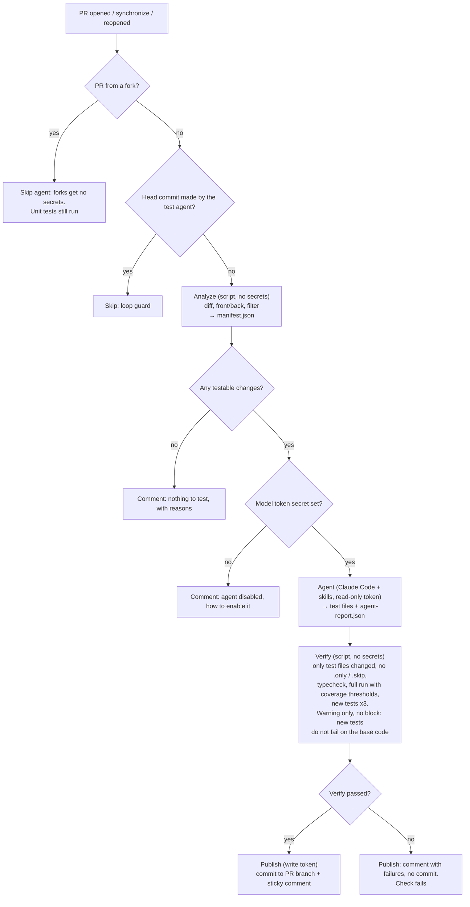

# Unit Test Agent: solution notes

A Claude Code agent, three skills and a GitHub workflow write unit tests for the Taskly app on every pull request. The agent decides per changed file: create tests, update tests or skip. A script then checks its work. Only checked tests are committed to the PR, with one comment that shows each decision and its reason.

## How it works



Four jobs in `.github/workflows/test-agent.yml`, one of them calls a model. Analyze lists the changed files and drops what cannot be unit tested. The agent writes test files and `agent-report.json` as a patch and pushes nothing. Verify applies the patch and runs checks the agent cannot influence. Publish is the only job with write access.

## Where things live

- Agent: `.claude/agents/unit-test-agent.md` (role, tools, decision rules, error handling, report format). It runs on `claude-sonnet-5-5` and preloads `test-case-design`.
- Skills in `.claude/skills/`: `test-case-design` (plan cases, name the break each one catches), `backend-unit-tests` and `frontend-unit-tests` (which entry point to test through, how to fake Prisma or the network). The agent loads the backend or frontend skill before writing a test on that side, and reads their longer reference files only when needed.
- Scripts: `scripts/run-agent.sh` starts the agent with the same limits locally and in CI. `analyze-pr.mjs` and `verify-agent.mjs` have their own tests.
- `CLAUDE.md` holds the project's test rules for the agent.

## Technical decisions

- **A model only where judgment is needed.** Choosing what to test needs one. Listing files, checking results and posting the comment are scripts: cheap, repeatable, testable. No testable change, no model call.
- **The agent cannot commit.** It produces a patch, Verify checks it, and Publish commits it. Publish never runs code from the PR.
- **Expected values come from the contract:** PR description, signatures, validators, `openapi.json`. Never from running the code under test.
- **Mocks only at system boundaries** (network, database, time) in new files. Existing test files keep their mocks. If a change adds a dependency the old file does not mock, the agent adds only that mock.
- **Bounded effort.** Three attempts per file. A test that still fails is deleted and named in the report. A test that exposes a likely bug becomes `suspected_bug` with expected and actual values, and the assertion is never bent to fit the code.
- **Unit tests only.** That is the assignment, and the limit is three days. Integration and E2E tests need a database or a browser and would slow Verify, which runs the new tests three times.
- **Three skills, not five.** A skill that repeats a script spends context and can drift from it, so the skills hold only what needs judgment: test design and the two stacks.
- **"Fails on the old code" warns, it does not block.** A refactor can leave behavior unchanged, so its tests pass on the old code too.
- **One comment per PR,** found by a hidden marker and updated on every run.
- **Sonnet, not Haiku,** pinned by full ID so behavior changes only with the repository. On the emoji bug (issue #7) Haiku missed it in `utils/todos.ts` and Sonnet found it, at $0.21 for that file. Haiku is cheaper ($0.013 against $0.153 on `router.ts`), but CI shows the agent only changed files, so the cost is acceptable.

## Security

PR code, comments and text are untrusted input. The protection is permissions and checks. It does not rely on the prompt.

- Minimal permissions per job. Only Publish writes. The workflow uses `pull_request`, not `pull_request_target`, and skips forks.
- The agent has no web tools, because the network could leak data or bring in outside instructions.
- `CLAUDE_CODE_SUBPROCESS_ENV_SCRUB=1` hides the model token from every command the agent runs. A workflow step checks this on each run and fails if the token was visible.
- The agent may only run `npx vitest run`, `npx tsc --noEmit` and `cd` into the two folders. It cannot read `.env` or edit source, config or package files.
- Verify rejects changes outside test files, any `.only` or `.skip`, and secret-like strings.
- PR title and body go through environment variables, never into a shell script. Actions are pinned by SHA. The agent's commit carries `[skip ci]`: runs started by a push with the built-in token waited for approval, and auto-approving them would remove that protection.

## Running it

Prerequisites: Node 24, a GitHub repository with Actions enabled and, for local runs, Claude Code installed and signed in. CI pins Claude Code 2.1.301.

On GitHub:
1. Run `claude setup-token` in a terminal (it needs a Claude subscription) and copy the token it prints.
2. Add it as the repository secret `CLAUDE_CODE_OAUTH_TOKEN` under Settings, Secrets and variables, Actions.
3. Open a pull request from a branch in this repository.
4. After a few minutes the agent's commit and one comment appear. A new push updates the same comment.

Without the secret the workflow still runs, and the comment says the agent did not run. To see a full run without it, open PR [#15](https://github.com/ArtemProkopenko123/cf_testing_agent/pull/15) and its Actions runs, listed below.

Locally, from the repository root, after `npm ci` in `backend/` and `frontend/`:

```sh
scripts/run-agent.sh "Write tests for backend/src/features/todos/validators.ts. Write the report to agent-report.json."
```

The agent leaves the test files in the working tree, uncommitted, and writes `agent-report.json`, which git ignores.

## Example run

Demo PR [#15](https://github.com/ArtemProkopenko123/cf_testing_agent/pull/15): a "Clear completed" button and `DELETE /api/todos?completed=true`, written without tests.

| File | Decision | Why |
|---|---|---|
| `repository.ts`, `router.ts`, `validators.ts` (backend) | update | Tests existed; the change added a method, a route, a schema. |
| `useClearCompletedMutation.ts` | create | New file, no test. |
| `TodosPage.tsx`, `TodosHeader.tsx`, `api/todos.ts` | update | Existing tests, new behavior. |
| `README.md`, `openapi.json`, `types.ts`, `queryKeys.ts` | skip | Documentation, specification, types only, excluded from coverage. |

| Push | Run | Result |
|---|---|---|
| Feature without tests | [45827602587](https://github.com/ArtemProkopenko123/cf_testing_agent/actions/runs/45827602587) | Verify **failed**, nothing committed. |
| Agent instructions fixed | [45831272653](https://github.com/ArtemProkopenko123/cf_testing_agent/actions/runs/45831272653) | Passed: 24 tests, commit `5df28b8`. |
| Endpoint also returns `ids` | [45831983976](https://github.com/ArtemProkopenko123/cf_testing_agent/actions/runs/45831983976) | Passed: five existing test files updated, commit `9ce6370`. |

In the first run the agent wrote its `TodosPage` tests in a new file and left `TodosPage.test.tsx` alone. That file mocks the page's hooks, so five old tests failed on the new, unmocked hook. Verify ran the whole frontend suite, caught it and blocked the commit. The fix (`959b845`) tells the agent to add the missing mock and to run the whole suite of each side before its report. The second run added only a mock for the new hook.

In the third run, after the behavior change, the agent edited its existing cases to the new `{ count, ids }` response and added two cases, instead of adding tests next to the old ones. It edited its PR comment in place. The comment lists each file's decision, result, test count and reason, the planned cases with the break each catches, and Verify's checks.

PRs #10 and #11 fixed two bugs found earlier (issues #7 and #6). The agent wrote the regression tests in CI, and Verify confirmed they fail on the old code.

## Results

| | Start | Now (`main`) |
|---|---|---|
| Backend statements | about 30% | 98.5% (lines 100%) |
| Frontend statements | about 46% | 96.8% (lines 98.2%) |
| Tests | n/a | 105 backend, 157 frontend |

Thresholds in both vitest configs are raised, and `validators.ts` and `mappers.ts` stay at 100%. `main.ts` is excluded because it only starts the server.

## Assumptions

PRs come from branches in this repository. The app's tests need no database or network. The PR description states the intended behavior. A person changes source code; the agent only writes tests and nothing is merged automatically.

## Limitations

- The report example has a `skills_used` field, but Verify does not check it, so the report cannot prove which skills ran.
- Coverage is checked against fixed thresholds, not as a change per PR. Test strength is not measured.
- The agent's commit starts no other workflows, so the required CI skips it. Verify ran the tests in the same workflow. A squash merge also copies `[skip ci]` into the commit on `main`, so edit the message before merging.
- Verify runs from the PR branch's copy of `scripts/`. That is fine here, since forks do not run and the agent cannot edit `scripts/`, but a hostile author with access to this repository could change it.
- The agent is nondeterministic. A rerun can produce different tests.
- A `suspected_bug` is only reported, and a person has to read it. One agent run covers the whole PR, so a very large change may hit the turn limit.

## Changes for production

- Run Verify from `main`, not from the PR branch.
- Add integration tests against a real Postgres. The schema is created by raw SQL, and mocks do not check it.
- Commit with a GitHub App token so the required CI runs on the agent's commit.
- Add mutation testing (Stryker) on changed files, first without blocking.
- Report the coverage change of each PR.
- Make Verify compare `skills_used` with the run log.
- Add an optional LLM judge for assertion quality, and a small evaluation set (create, update, skip, planted bug) run when the agent or skills change.
- Allow fork PRs behind a maintainer label. Cap the cost per run and per month.
